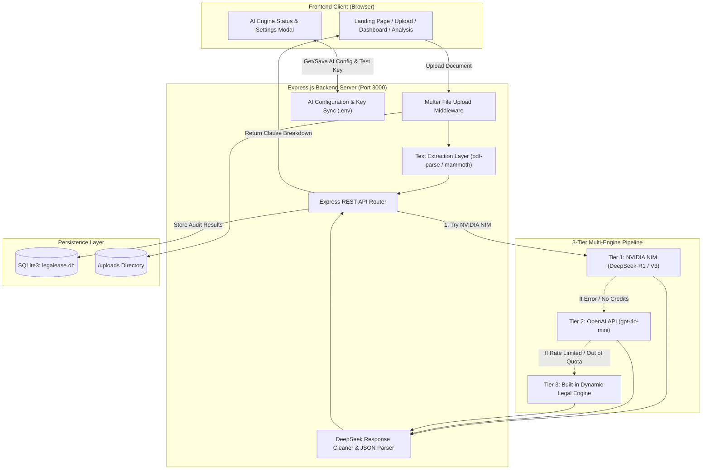

# LegalEase — AI-Powered Contract Risk Auditor & Legal Intelligence

> **Demystifying complex legal agreements with deep reasoning AI, instant risk detection, and plain-English translations.**

[](https://nodejs.org/)
[](https://expressjs.com/)
[](https://www.sqlite.org/)
[](https://build.nvidia.com/)
[](https://opensource.org/licenses/ISC)

---

## Table of Contents
- [Project Title and Introduction](#project-title-and-introduction)
- [Problem Statement](#problem-statement)
- [Key Features](#key-features)
- [Screenshots of Website](#screenshots-of-website)
- [Tech Stack](#tech-stack)
- [System Architecture](#system-architecture)
- [Installation and Setup Instructions](#installation-and-setup-instructions)
- [API Endpoints](#api-endpoints)
- [Your Contributions](#your-contributions)
- [Team Acknowledgements](#team-acknowledgements)

---

## Project Title and Introduction

**LegalEase** is a web-based legal technology application engineered to audit contracts, surface predatory covenants, and bridge the knowledge gap between complex legal jargon and everyday decision-makers.

Whether evaluating a freelance master services agreement, commercial lease, software consulting contract, or non-disclosure agreement (NDA), LegalEase provides users with instant visibility into risk exposure, plain-English explanations of contractual obligations, and specific, copy-paste counter-proposal redline language.

Powered by a **3-tier multi-model AI pipeline** featuring **NVIDIA NIM (DeepSeek-R1 and DeepSeek-V3)** with **OpenAI (`gpt-4o-mini`)** and a **dynamic built-in legal engine** as zero-failure fallbacks, LegalEase delivers legal-grade contract scrutiny within seconds.

---

## Problem Statement

Every day, freelancers, startups, small business owners, and employees sign binding agreements that contain dangerous legal provisions:
- **Unlimited Indemnification**: Exposing individuals to unbounded financial defense costs.
- **Predatory Non-Competes**: Restricting professional career mobility and freelance ventures for years.
- **Overreaching Intellectual Property Transfers**: Accidentally surrendering ownership of personal side-projects or pre-existing code.
- **Unilateral Termination & Forfeitures**: Allowing counterparties to cancel without cause or confiscate security deposits without cure periods.

Traditional legal review is expensive, with attorneys billing hundreds of dollars per hour, causing most individuals to sign contracts unread. Existing general-purpose chatbots often produce superficial, hallucinated legal answers without verbatim contract references, structured risk classifications, or actionable redline amendments.

**LegalEase solves this problem** by providing an accessible, automated contract auditor that extracts actual contract clauses, grades risk severity, explains real-world legal impacts, and generates ready-to-send negotiation counter-proposals.

---

## Key Features

### 📄 Multi-Format Document Ingestion
- Upload documents in **PDF**, **DOCX**, **DOC**, or **TXT** formats (up to 10 MB).
- Automatic text sanitization and parsing to strip binary stream artifacts and extract clean clauses.

### 🧠 Deep Legal Reasoning with NVIDIA DeepSeek-R1 & V3
- Integrated with **NVIDIA NIM API** (`https://integrate.api.nvidia.com/v1`) using OpenAI-compatible architecture.
- **DeepSeek-R1 Reasoning**: Performs deep chain-of-thought analysis to uncover hidden liabilities and cross-clause traps.
- **DeepSeek-V3 Fast Mode**: High-speed, high-throughput model for rapid contract triage.
- **Automatic Output Sanitization**: Transparently strips reasoning `<think>...</think>` tokens and guarantees clean, valid JSON responses.

### 🛡️ 3-Tier Multi-Engine Resilience
- **Tier 1 (Primary)**: NVIDIA NIM DeepSeek (R1 / V3).
- **Tier 2 (Cloud Fallback)**: OpenAI API (`gpt-4o-mini`).
- **Tier 3 (Local Fallback)**: Built-in dynamic legal rule engine that audits contracts offline even if internet or cloud credits are exhausted.

### 📊 Comprehensive Legal Audit Memorandum
- **Fairness & Risk Score**: Evaluates overall contract equity (e.g., *7.8/10 Moderate Risk Exposure*).
- **Verbatim Legal Quotation**: Cites exact contractual text directly from the uploaded file.
- **Plain-English Impact Analysis**: Explains what rights you surrender and what duties you assume.
- **Specific Redline Counter-Proposals**: Generates concrete amendment language ready to request from counterparties.
- **Table of Provisions Navigator**: Sticky sidebar navigation for quickly browsing clauses (§1, §2, §3...).

### ✉️ 1-Click Negotiation Email Generator
- Converts audit recommendations into an executive negotiation letter addressed to counterparty counsel.
- Includes 1-click **Copy Letter**, **Download .TXT**, and **Open in Email App (`mailto:`)** buttons.

### ⚙️ Interactive In-App AI Settings
- Header status badge showing active AI engine status (`DeepSeek R1 Active` or `Add NVIDIA Key`).
- Settings modal allowing users to enter their NVIDIA Build API key (`nvapi-...`), select DeepSeek models, test live connections, and save configurations dynamically without server restarts.

### 💾 Persistent SQLite Database
- Stores audit history, extracted clauses, risk statistics, user accounts, and contact submissions locally in `legalease.db`.

---

## Screenshots of Website

| Landing Page & Contract Preview | Document Upload & AI Status |
| :---: | :---: |
|  |  |
| *Modern landing page with interactive clause inspector* | *Drag & drop upload portal with live AI engine badge* |

| Executive Legal Memorandum | Negotiation Letter Modal |
| :---: | :---: |
|  |  |
| *Deep clause breakdown with risk ratings & redlines* | *Customizable negotiation letter ready to send* |

| AI Model & NVIDIA API Key Settings | Client Audit Dashboard |
| :---: | :---: |
|  |  |
| *Live NVIDIA NIM DeepSeek connection tester* | *Audit queue, metrics, and contract history* |

> *Tip: Place your application screenshot files in `docs/screenshots/` to display them in GitHub preview.*

---

## Tech Stack

### Frontend
- **HTML5 & CSS3**: Custom clean editorial design system with typography tailored for legal readability (`Playfair Display` & `Plus Jakarta Sans`).
- **Vanilla ES6 JavaScript**: Pure client-side logic with zero framework bloat, fast load times, and dynamic DOM manipulation.
- **Google Material Symbols**: Clean iconography across navigation, badges, and action triggers.

### Backend
- **Node.js**: Asynchronous event-driven JavaScript runtime.
- **Express.js (v5)**: REST API framework routing file uploads, authentication, and AI configuration.
- **Multer**: Multi-part form data handler managing contract file uploads.
- **pdf-parse & Mammoth**: Binary parsing engines extracting clean raw text from PDF and DOCX files.
- **dotenv**: Environment variable management with runtime synchronization.

### AI & Language Models
- **NVIDIA NIM API**: OpenAI-compatible endpoint (`https://integrate.api.nvidia.com/v1`) hosting `deepseek-ai/deepseek-r1` and `deepseek-ai/deepseek-v3`.
- **OpenAI SDK (`openai`)**: Client library utilized for both NVIDIA NIM and OpenAI completions.
- **Dynamic Rule Engine**: Built-in pattern-matching engine using contractual keywords and legal risk heuristics.

### Database
- **SQLite3**: Lightweight, zero-config relational database storing user records, document audits, and contact messages in `legalease.db`.

---

## System Architecture



---

## Installation and Setup Instructions

### Prerequisites
- [Node.js](https://nodejs.org/) (version 18.0.0 or higher recommended)
- `npm` (bundled with Node.js)
- (Optional) NVIDIA Build API key from [build.nvidia.com](https://build.nvidia.com/deepseek-ai/deepseek-r1)
- (Optional) OpenAI API key from [platform.openai.com](https://platform.openai.com/)

### 1. Clone the Repository
```bash
git clone https://github.com/your-username/legalease.git
cd legalease
```

### 2. Install Dependencies
```bash
npm install
```

### 3. Configure Environment Variables
Copy the example environment configuration file:
```bash
# On Linux / macOS:
cp .env.example .env

# On Windows PowerShell:
Copy-Item .env.example .env
```

Open `.env` and set your credentials:
```env
PORT=3000

# NVIDIA Build API Key for DeepSeek (from https://build.nvidia.com)
NVIDIA_API_KEY=nvapi-your-key-here
NVIDIA_MODEL=deepseek-ai/deepseek-r1
NVIDIA_BASE_URL=https://integrate.api.nvidia.com/v1
AI_PROVIDER=nvidia

# (Optional) OpenAI API Key fallback
OPENAI_API_KEY=
```
*(Note: You can also leave the API keys blank and configure them directly in the browser UI via the AI Settings modal).*

### 4. Start the Application
```bash
npm start
# or
node server.js
```

### 5. Open in Your Browser
Visit: **[http://localhost:3000](http://localhost:3000)**

---

## API Endpoints

| Method | Endpoint | Description | Sample Payload / Params |
| :--- | :--- | :--- | :--- |
| `POST` | `/api/auth/login` | Authenticate or auto-register client workspace user | `{"email": "alex@legalease.io", "name": "Alex"}` |
| `GET` | `/api/documents` | Fetch all audited contracts for a user | `?email=alex@legalease.io` |
| `GET` | `/api/documents/:id` | Retrieve single document audit report by ID | URL parameter `:id` |
| `POST` | `/api/documents` | Save document audit record manually | JSON document metadata object |
| `POST` | `/api/documents/upload-file` | Upload file (PDF/DOCX/TXT) and execute AI legal audit | Multipart `FormData` (`file`, `user_email`, `category`) |
| `GET` | `/api/config/ai` | Get active AI provider, model, and masked keys | None |
| `POST` | `/api/config/ai` | Update active AI engine, model, and NVIDIA key | `{"nvidiaApiKey": "nvapi-...", "nvidiaModel": "deepseek-ai/deepseek-r1"}` |
| `POST` | `/api/config/ai/test` | Live test NVIDIA NIM connection with DeepSeek model | `{"nvidiaApiKey": "nvapi-...", "nvidiaModel": "..."}` |
| `POST` | `/api/contact` | Submit inquiry form and save to database | `{"name": "Jane", "email": "jane@co.com", "message": "..."}` |

---

## Your Contributions

- **Architected Multi-Tier AI Pipeline**: Designed and engineered the 3-tier fallback architecture supporting NVIDIA NIM (DeepSeek-R1 / DeepSeek-V3), OpenAI (`gpt-4o-mini`), and the built-in offline dynamic engine.
- **DeepSeek Reasoning Normalizer**: Implemented robust regex and substring extraction to strip `<think>` tokens and guarantee resilient JSON parsing.
- **Interactive AI Key Management**: Built the in-app modal and backend endpoints (`/api/config/ai`, `/api/config/ai/test`) allowing runtime configuration and verification of NVIDIA API keys without server restarts.
- **Full-Stack File Extraction Pipeline**: Implemented parsing and sanitization for PDF, DOCX, and TXT documents using `pdf-parse` and `mammoth`.
- **Editorial Legal Design System**: Crafted a human-centered, responsive user interface with cohesive typography, provision navigation sidebar, and 1-click counter-proposal email drafting.

---

## Team Acknowledgements

Special thanks and appreciation to:
- **NVIDIA Developer Program & NVIDIA NIM** for providing API access to high-performance DeepSeek-R1 and DeepSeek-V3 models.
- **DeepSeek AI** for open-weights reasoning model innovation.
- **OpenAI** for developer APIs and SDK tooling.
- **The Open Source Community** for maintaining critical parsing libraries (`pdf-parse`, `mammoth`, `multer`, `sqlite3`).
- **Mentors and Peers** whose feedback shaped the contract audit heuristics and plain-English translation workflows.

---

<p align="center">
  <b>LegalEase</b> — Empowering everyone to sign with confidence.
</p>
